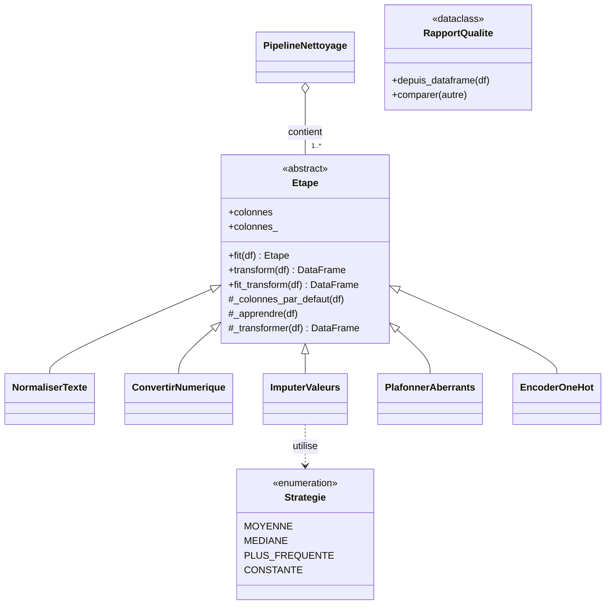

# Projet 1 — Pipeline de nettoyage de données (pandas)

> **Modules mobilisés** : 1 à 7 (surtout 3 héritage, 5 abstraction, 6 composition, 7 erreurs)
> **Durée indicative** : 4 à 6 heures
> **Lancer la correction** : `python -m projets.p1_nettoyage.demo` · **Tests** : `pytest tests/test_p1_nettoyage.py`

## Contexte

Une boutique en ligne vous transmet un export de sa base clients pour prédire les
résiliations (`a_resilie`). Comme toujours, les données sont sales :

| Défaut | Exemple |
|---|---|
| Doublons exacts | ~3 % des lignes en double |
| Nombres stockés en texte | `age` vaut `"34"`, `"inconnu"`, `""` |
| Valeurs manquantes | `revenu_annuel` (~12 %), `ville`, `segment` |
| Valeurs aberrantes | quelques revenus multipliés par 20 |
| Saisie incohérente | `"Paris"`, `" paris"`, `"PARIS "` |

`donnees.generer_clients(n, graine)` produit ce jeu de données (reproductible, sans téléchargement).

**Objectif** : construire une petite bibliothèque **orientée objet** de nettoyage, réutilisable,
qui apprend ses paramètres sur le train et les applique **à l'identique** au test.

## Architecture attendue

## Cahier des charges

### 1. `Etape` — classe abstraite (méthode patron)

- `__init__(colonnes=None)` : stocke une **copie** de la liste (ou `None` = colonnes par défaut).
- `fit(df)` : vérifie que `df` est un DataFrame (`TypeError`) et que les colonnes existent
  (`KeyError`), mémorise `colonnes_`, appelle le crochet `_apprendre(df)`, **renvoie `self`**.
- `transform(df)` : `RuntimeError` si non entraînée ; vérifie le type et les colonnes ;
  appelle `_transformer` sur **une copie** de `df`. ➜ La copie défensive est écrite **une seule
  fois**, dans le parent : aucune sous-classe ne peut modifier l'entrée par erreur.
- `_transformer(df)` est **abstraite** ; `_apprendre` et `_colonnes_par_defaut` ont un comportement par défaut.

### 2. Les étapes concrètes

| Classe | Apprend (dans `fit`) | Applique (dans `transform`) |
|---|---|---|
| `NormaliserTexte` | rien | `str.strip().str.lower()` ; colonnes texte par défaut |
| `ConvertirNumerique(colonnes)` | `valeurs_invalides_` : les valeurs non convertibles vues (pour **ne rien cacher**) | `pd.to_numeric(errors="coerce")` → NaN |
| `ImputerValeurs(colonnes, strategie, valeur)` | `valeurs_` : moyenne / médiane / modalité la plus fréquente / constante | `fillna(valeurs_)` |
| `PlafonnerAberrants(colonnes, k=1.5)` | `bornes_` : `[Q1 − k·IQR, Q3 + k·IQR]` | `clip` |
| `EncoderOneHot(colonnes)` | `categories_` (triées) | une colonne 0/1 par catégorie apprise ; inconnue ou manquante → que des 0 |

Validations attendues : stratégie inconnue → `ValueError` (grâce à l'`Enum`), moyenne sur une
colonne texte → `TypeError`, colonne entièrement vide → `ValueError`, `k <= 0` → `ValueError`.

### 3. `PipelineNettoyage` — composition

- Contient une liste d'`Etape` (vide → `ValueError`, autre objet → `TypeError`).
- `fit_transform` enchaîne les étapes **et remplit un journal** (`journal()` → DataFrame :
  lignes, colonnes et manquants avant/après chaque étape).
- `transform` applique les étapes déjà entraînées (`RuntimeError` sinon).
- `__len__`, `__getitem__`, `__repr__`.

### 4. `RapportQualite` — dataclass

`RapportQualite.depuis_dataframe(df)` (constructeur alternatif) : lignes, colonnes, doublons,
manquants par colonne, types ; propriétés `total_manquants`, `taux_manquants` ; `__str__` lisible ;
`comparer(autre)` → tableau avant/après.

### 5. `supprimer_doublons(df)` — une **fonction**, pas une classe

Elle n'apprend rien (inutile d'en faire une classe, module 7 erreur n°11) et elle **change le
nombre de lignes** : on l'applique une fois sur le jeu complet, **avant** de séparer X/y et train/test.

## Étapes de réalisation conseillées

1. Explorez les données : `generer_clients().head(20)`, `.info()`, `.isna().sum()`.
2. Écrivez `Etape` puis **une seule** sous-classe (`NormaliserTexte`) ; testez-la.
3. Ajoutez les autres étapes une par une, avec un petit test à chaque fois.
4. Écrivez `PipelineNettoyage`, puis le scénario complet (`demo.py`) :
   doublons → X/y → train/test → `fit_transform(X_train)` → `transform(X_test)`.
5. Vérifiez **systématiquement** : aucune valeur manquante, mêmes colonnes dans le même ordre
   sur train et test, même nombre de lignes qu'en entrée, index conservé (alignement avec `y`),
   entrée non modifiée.

## ⚠️ Pièges data science à éviter

- **Fuite de données** : toute statistique (médiane, bornes, catégories) est apprise sur le
  **train uniquement**. Faire `fit` sur le jeu complet avant de séparer gonfle les scores de test.
- **Supprimer des lignes dans `transform`** : X et y se désalignent. On **plafonne** les aberrants.
- **Catégories inconnues au test** : si l'encodage one-hot est recalculé sur le test, les colonnes
  ne correspondent plus à celles vues par le modèle. On apprend les catégories en `fit`.
- **Ordre des étapes** : convertir en numérique **avant** d'imputer par la médiane ; normaliser le
  texte **avant** d'imputer la modalité la plus fréquente et d'encoder.
- **pandas ≥ 3** : les colonnes texte ont le type `str` (plus `object`). Pour repérer les colonnes
  numériques, utilisez `pandas.api.types.is_numeric_dtype` plutôt que `select_dtypes("object")`.

## Pour aller plus loin

- Une étape `CreerVariables` (ex. `revenu_par_achat`) et une étape `SupprimerColonnes`.
- `ImputerValeurs(strategie="mediane", par_groupe="segment")` : imputation par groupe.
- Un accesseur pandas `df.qualite.rapport()` (module 7, erreur n°9).
- Brancher le résultat sur le projet 2 (`RegressionLogistique`) pour prédire `a_resilie`.
