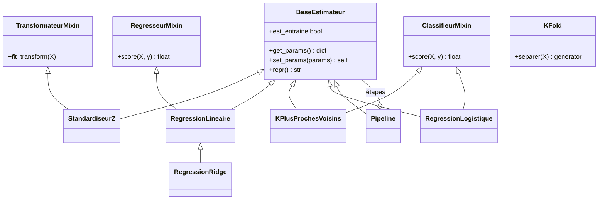

# Projet 2 — Écrire son propre mini scikit-learn (NumPy)

> **Modules mobilisés** : tous (surtout 2 encapsulation, 3 héritage/mixins, 4 méthodes spéciales, 5 méthode patron)
> **Durée indicative** : 6 à 10 heures
> **Lancer la correction** : `python -m projets.p2_mini_sklearn.demo` · **Tests** : `pytest tests/test_p2_mini_sklearn.py`

## Objectif

Comprendre **comment scikit-learn est conçu** en le réécrivant en miniature. À la fin, vous
saurez pourquoi `fit` renvoie `self`, pourquoi les attributs appris finissent par `_`, à quoi
servent `get_params`/`clone`, et pourquoi la validation croisée doit cloner l'estimateur.

## Architecture

| Fichier | Contenu |
|---|---|
| `base.py` | `BaseEstimateur`, les mixins, `NonEntraineError`, `verifier_X`, `verifier_X_y`, `clone` |
| `pretraitement.py` | `StandardiseurZ` |
| `modeles.py` | `RegressionLineaire`, `RegressionRidge`, `KPlusProchesVoisins`, `RegressionLogistique` |
| `metriques.py` | des **fonctions** : `r2`, `exactitude`, `erreur_quadratique_moyenne`… |
| `selection.py` | `separer_train_test`, `KFold`, `validation_croisee` |
| `pipeline.py` | `Pipeline` avec la syntaxe `set_params(modele__alpha=10)` |

## Les conventions (celles de scikit-learn)

1. `__init__` **stocke** les hyperparamètres sous le **même nom** que l'argument, sans calcul.
   C'est ce qui permet à `get_params` de les retrouver par introspection
   (`inspect.signature(cls.__init__)`).
2. Les hyperparamètres sont **validés dans `fit`**, pas dans `__init__` : `set_params` peut
   les changer après la création, et `clone` doit pouvoir recréer l'objet sans effet de bord.
   (Au module 2, on validait dans un setter : c'est très bien pour un objet isolé, mais
   incompatible avec ce mécanisme générique.)
3. Les attributs **appris** se terminent par `_` et ne sont créés que dans `fit` :
   `est_entraine` se contente de vérifier leur présence.
4. `fit` renvoie `self` ; `predict`/`transform` lèvent `NonEntraineError` avant `fit`.
5. Toute entrée est validée : `X` 2D sans NaN, `y` 1D (une shape `(n, 1)` est aplatie
   **explicitement**), même nombre de lignes, même nombre de colonnes qu'en `fit`.

## Cahier des charges

### Étape 1 — `base.py`
- `get_params()`, `set_params(**params)` (paramètre inconnu → `ValueError`), `__repr__` générique.
- Mixins : `TransformateurMixin.fit_transform`, `RegresseurMixin.score` (R²), `ClassifieurMixin.score` (exactitude).
- `clone(estimateur)` : nouvel objet **non entraîné**, mêmes hyperparamètres, estimateurs imbriqués clonés aussi.

### Étape 2 — `RegressionLineaire` et `RegressionRidge` (méthode patron)
- `fit` centre `X` et `y` (si `ajuster_intercept`), délègue la résolution à `_resoudre`,
  puis calcule `intercept_ = moyenne_y − moyenne_X · coef_`.
- `RegressionLineaire._resoudre` : `np.linalg.lstsq`.
- `RegressionRidge(RegressionLineaire)` ne redéfinit **que** `_resoudre` :
  `(XᵀX + αI)⁻¹ Xᵀy` (avec `np.linalg.solve`, jamais `np.linalg.inv`). Centrer permet de **ne pas
  pénaliser l'intercept**.
- Vérification : avec `alpha=0`, Ridge donne les mêmes coefficients que la régression linéaire ;
  plus `alpha` augmente, plus la norme des coefficients diminue.

### Étape 3 — `KPlusProchesVoisins(k=5)`
- `fit` mémorise une **copie** de `X`, encode `y` avec `np.unique(y, return_inverse=True)`
  (`classes_` peut contenir des chaînes).
- `predict` : distances par broadcasting `(n_test, 1, d) − (1, n_train, d)`, `argsort`, vote
  majoritaire (`np.add.at`). **Écrivez la shape de chaque tableau en commentaire.**

### Étape 4 — `RegressionLogistique` (binaire, descente de gradient)
- `historique_pertes_` doit **décroître** ; `predict_proba` renvoie un tableau `(n, 2)` dont les
  lignes somment à 1 ; plus de deux classes → `ValueError`.

### Étape 5 — `selection.py`
- `separer_train_test` applique la **même** permutation à `X` et `y`.
- `KFold.separer(X)` : chaque exemple est **exactement une fois** en validation ; reproductible avec `graine`.
- `validation_croisee` **clone** l'estimateur à chaque pli et n'entraîne jamais l'original.

### Étape 6 — `Pipeline`
- `Pipeline([("standardiser", StandardiseurZ()), ("modele", RegressionRidge())])`.
- `set_params(modele__alpha=10)` règle l'hyperparamètre d'une étape (utilisé par le projet 3).

## ⚠️ Pièges à surveiller

- **Shapes** : `(n,)` contre `(n, 1)` → broadcasting en `(n, n)` (module 7, erreur n°17).
- **Ridge sans standardisation** : la pénalité frappe surtout les variables de petite échelle
  (voir la section 3 de la démo : le coefficient de `x0`, d'écart-type 1, s'effondre en premier).
  ➜ toujours `StandardiseurZ` **dans** le pipeline.
- **Fuite en validation croisée** : standardiser tout `X` **avant** la validation croisée utilise
  les statistiques des plis de validation. Le pipeline + `clone` règle le problème.
- **`np.linalg.inv`** : instable numériquement ; préférez `solve` ou `lstsq`.
- **KNN** : la mémoire est en O(n_test × n_train × d). Suffisant pour apprendre, pas pour la production.

## Pour aller plus loin

- `NormaliseurMinMax`, `ImputeurMoyenne` dans `pretraitement.py`.
- `KPlusProchesVoisinsRegresseur` : réutiliser le calcul des voisins via un mixin commun.
- Comparer vos résultats à scikit-learn (`pip install scikit-learn`) : mêmes coefficients pour
  `LinearRegression`/`Ridge`, mêmes plis pour `KFold(shuffle=False)`.
