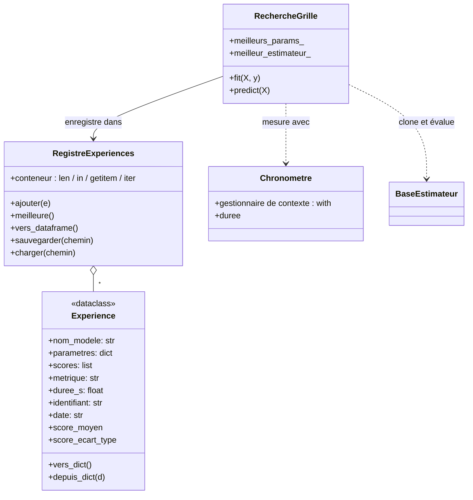

# Projet 3 — Suivi d'expériences et recherche d'hyperparamètres

> **Modules mobilisés** : 4 (gestionnaire de contexte, conteneur), 6 (dataclass, composition), 7 ; s'appuie sur le projet 2
> **Durée indicative** : 3 à 5 heures
> **Lancer la correction** : `python -m projets.p3_suivi_experiences.demo` · **Tests** : `pytest tests/test_p3_suivi_experiences.py`

## Contexte

Vous testez des dizaines de combinaisons d'hyperparamètres. Sans organisation, les résultats
finissent dans des `print` perdus ou un tableur rempli à la main. Vous allez construire un
mini-équivalent de MLflow : chaque essai est enregistré, comparable et sauvegardé.

## Architecture

## Cahier des charges

### 1. `Experience` (`@dataclass`)
- Champs ci-dessus ; `identifiant` (8 caractères hexadécimaux) et `date` (ISO) générés par
  `field(default_factory=...)` — **jamais** une valeur par défaut calculée une seule fois.
- `__post_init__` : `nom_modele` non vide, `parametres` est un `dict` (`TypeError`), au moins un
  score, aucun NaN, `duree_s >= 0` (`ValueError`). Convertit les scores en `float` Python
  (un `np.float64` n'est pas sérialisable tel quel… et rend le JSON illisible).
- Propriétés `score_moyen` et `score_ecart_type` ; `vers_dict()` / `depuis_dict()` (aller-retour exact).

### 2. `RegistreExperiences` (composition + protocole conteneur)
- `ajouter(e)` : `TypeError` si ce n'est pas une `Experience`, `ValueError` si l'identifiant existe déjà.
- `len(r)`, `for e in r`, `"a1b2c3d4" in r`, `r["a1b2c3d4"]` (`KeyError` sinon).
- `meilleure(plus_grand_est_meilleur=True)` : `ValueError` si vide **ou si les métriques diffèrent**
  (comparer un R² à une MAE n'a aucun sens).
- `vers_dataframe()` : une ligne par expérience, une colonne `param_<nom>` par hyperparamètre.
- `sauvegarder(chemin)` (JSON, dossiers créés si besoin) et `charger(chemin)` (`@classmethod`).

### 3. `RechercheGrille`
- `RechercheGrille(estimateur, grille, cv, metrique, nom_metrique, plus_grand_est_meilleur, registre)`.
- Grille vide ou liste de valeurs vide → `ValueError` dès la création.
- `fit(X, y)` : pour chaque combinaison (`itertools.product`) : `clone(estimateur).set_params(...)`,
  validation croisée **chronométrée** (`with Chronometre() as c:`), création d'une `Experience`,
  ajout au registre. Puis `meilleurs_params_`, `meilleur_score_`, et `meilleur_estimateur_`
  **ré-entraîné sur toutes les données reçues**.
- `predict(X)` délègue à `meilleur_estimateur_` (`RuntimeError` avant `fit`).

## ⚠️ Pièges à surveiller

- **Le jeu de test ne sert qu'une fois**, à la toute fin : la recherche ne voit que le train
  (validation croisée interne). Choisir les hyperparamètres sur le test = fuite de données.
- **Un registre partagé** entre plusieurs recherches peut contenir des métriques différentes :
  la meilleure expérience d'une recherche se choisit parmi **ses** essais (`experiences_`).
- **Sérialisation** : `json.dumps(np.float64(1.0))` fonctionne (car `np.float64` hérite de
  `float`), mais `json.dumps(np.int64(1))` **échoue**. Convertissez en types Python.
- **Valeurs par défaut** : `date: str = datetime.now().isoformat()` serait évaluée **une seule
  fois** à l'import : toutes les expériences auraient la même date (module 7, erreur n°1).

## Pour aller plus loin

- `RechercheAleatoire` (échantillonnage aléatoire de la grille) en héritant d'une classe
  `RechercheBase` commune (méthode patron : seule la génération des combinaisons change).
- Ajouter des **étiquettes** (`tags`) aux expériences et une méthode `filtrer(**criteres)`.
- Un graphique score moyen ± écart-type en fonction d'un hyperparamètre (matplotlib).
