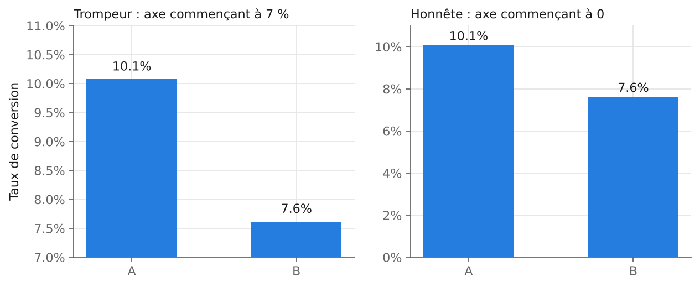
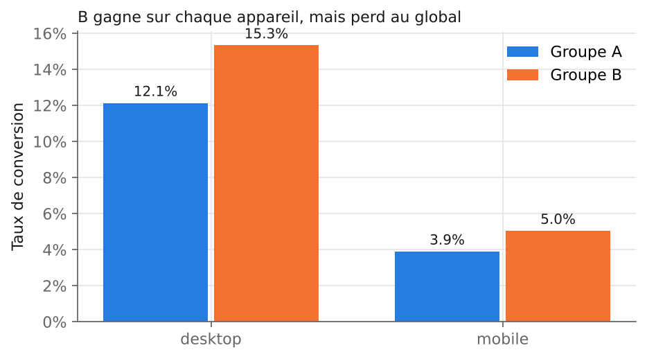
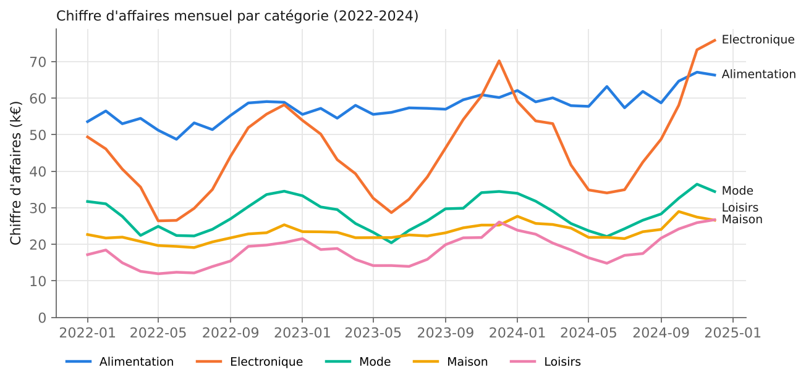
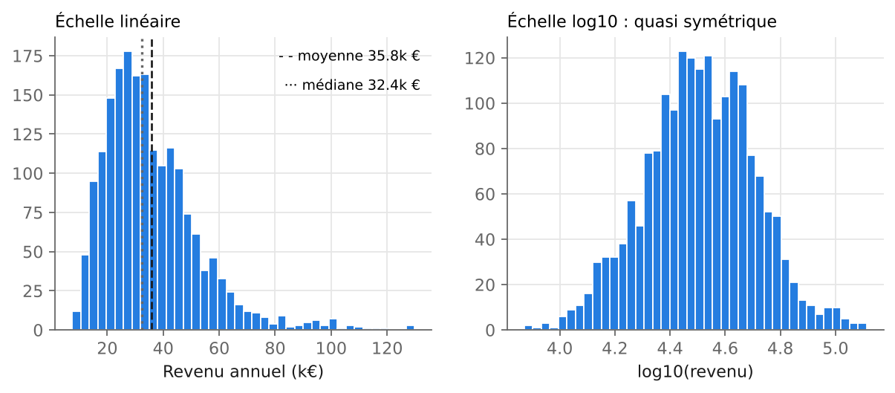
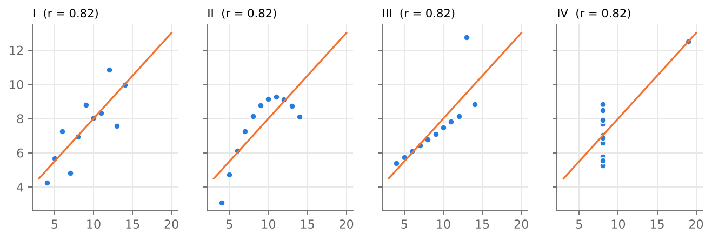
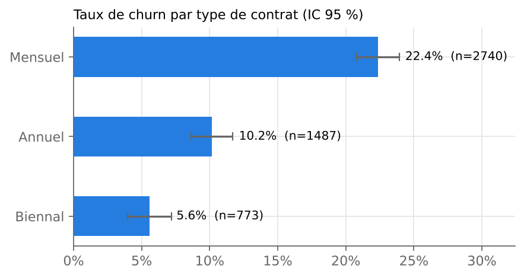

# Chapitre 5 — Visualisation : lire, critiquer, construire

> Script : `code/ch05_visualisation.py` — Figures produites dans `sorties/figures/`

Dans un rôle d'évaluation, vous **lirez** plus de graphiques que vous n'en produirez. Il faut savoir dire en quelques secondes ce qu'un graphique montre, ce qu'il cache et ce qu'il suggère à tort.

## 5.1 Choisir la forme selon la question

| Question | Forme adaptée | À éviter |
|---|---|---|
| Comparer des quantités entre catégories | barres (axe à zéro) | camembert à plus de 3 parts, barres 3D |
| Évolution dans le temps | lignes | barres pour de longues séries |
| Distribution d'une variable | histogramme, boîte à moustaches, densité | moyenne seule |
| Relation entre deux variables | nuage de points | coefficient de corrélation seul |
| Composition d'un total | barres empilées (peu de parts) | camembert multiple |
| Un seul chiffre clé | le chiffre lui-même, en grand | un graphique pour un nombre |

## 5.2 Exemple commenté : l'axe tronqué

Les deux graphiques montrent **les mêmes données** (10,1 % contre 7,6 %). À gauche, l'axe commence à 7 % : la barre A paraît environ **cinq fois** plus haute que B ((10,08 − 7) / (7,62 − 7) ≈ 5), alors que le rapport réel est de 1,32. Pour un graphique en **barres**, la longueur de la barre code la valeur : l'axe doit partir de zéro. Pour un graphique en **lignes**, un axe ne partant pas de zéro est acceptable, car c'est la pente qui porte l'information — à condition que l'axe soit lisible et étiqueté.

**Raisonnement de lecture en quatre questions :**

1. Que code chaque élément visuel (longueur, position, couleur, surface) ?
2. Les axes partent-ils de zéro quand ils le doivent ? Sont-ils linéaires ou logarithmiques ?
3. Quelle est la population et la période ? (Ici, le graphique ne dit pas que A et B n'ont pas reçu le même mélange d'appareils.)
4. Qu'est-ce que le graphique ne montre pas : incertitude, effectifs, segments ?

## 5.3 Rendre visible le paradoxe de Simpson

Les graphiques agrégés de la section précédente, même honnêtes sur l'axe, conduisent à la mauvaise conclusion. La décomposition par appareil montre que B est meilleur partout. **Une visualisation honnête peut porter une analyse fausse** : la critique d'un graphique ne s'arrête pas à sa forme.

## 5.4 Séries temporelles : tendance et saisonnalité

Lecture :

- L'Électronique a une forte saisonnalité avec un pic en fin d'année ; l'Alimentation est presque plate.
- Toutes les catégories ont une tendance croissante.
- Le ratio « décembre / autres mois » vaut 1,54 pour l'Électronique et 1,08 pour l'Alimentation (sortie du script).

> **Piège.** Ce ratio mélange saisonnalité **et** tendance (décembre est en fin d'année, donc après la croissance de l'année). Une comparaison propre de la saisonnalité utiliserait une décomposition (par exemple `statsmodels.tsa.seasonal_decompose`) ou comparerait décembre à la moyenne de la même année. Ce genre de nuance est typiquement absent des réponses générées automatiquement.

Choix de conception : étiquettes directes en bout de courbe, légende conservée, axe à zéro, une couleur fixe par catégorie (la couleur suit l'entité, pas son rang).

## 5.5 Distributions asymétriques

La moyenne (35,8 k€) est tirée vers la droite par une longue traîne ; la médiane (32,4 k€) décrit mieux le « client typique ». En échelle logarithmique, la distribution devient quasi symétrique : c'est la signature d'une loi log-normale (c'est bien ainsi que la donnée a été simulée). Un modèle linéaire sur `log(revenu)` sera souvent plus adapté que sur le revenu brut.

## 5.6 Le quartet d'Anscombe

Quatre jeux de 11 points ont **la même moyenne de x (9,00), la même moyenne de y (7,50), la même variance de y (≈ 4,12), la même corrélation (≈ 0,816) et la même droite de régression y = 3,00 + 0,500x.** Pourtant :

- I : relation linéaire bruitée — la régression est adaptée ;
- II : relation courbe — un modèle linéaire est faux ;
- III : relation linéaire parfaite sauf un point aberrant qui tord la droite ;
- IV : aucune relation, sauf un point isolé qui crée toute la corrélation.

Un LLM qui vous donne « r = 0,82, relation forte » sans graphique peut décrire n'importe lequel des quatre cas.

## 5.7 Montrer l'incertitude

Les barres d'erreur (IC 95 %, $\pm 1{,}96\sqrt{p(1-p)/n}$) et les effectifs affichés permettent de juger si les différences sont solides. Ici, les intervalles ne se chevauchent pas : les écarts entre contrats ne sont pas un artefact d'échantillonnage. (Attention à la règle inverse : des IC qui se chevauchent **n'impliquent pas** une différence non significative ; il faut tester la différence elle-même.)

## 5.8 Tableau, Power BI et outils de BI

Les mêmes principes s'appliquent dans Tableau ou Power BI ; les pièges propres à ces outils sont surtout liés à l'**agrégation implicite** :

- **Moyenne de moyennes** : une mesure `AVERAGE` posée sur une colonne déjà agrégée (taux par magasin) donne une moyenne non pondérée. Dans Power BI, préférez une mesure DAX `DIVIDE(SUM(conversions), SUM(visites))` à une moyenne de taux.
- **Contexte de filtre** (Power BI) ou **niveau de détail** (Tableau, expressions LOD `{FIXED ...}`) : un total qui change selon les filtres de la page est souvent la source d'écarts entre deux rapports.
- **Doublons de relation** : une relation plusieurs-à-plusieurs dans le modèle de données reproduit l'explosion de jointure du chapitre 2.
- **Axes automatiques** : certains visuels ne partent pas de zéro par défaut — vérifiez l'option.

> **Incertitude signalée.** Ce livre ne fournit pas de fichier Tableau ou Power BI (outils propriétaires non exécutables dans notre environnement de vérification). Les fichiers CSV et la base SQLite s'importent directement dans les deux outils pour reproduire les exercices.

## 5.9 Check-list de critique d'un graphique

1. Le type de graphique correspond-il à la question ?
2. Axes : zéro (barres), échelle, unités, titre explicite.
3. Population, période, source indiquées ?
4. Effectifs et incertitude visibles ?
5. Agrégation : moyenne de quoi ? pondérée ?
6. Couleurs : une couleur = une entité, pas de dégradé arc-en-ciel, lisible en daltonisme, pas de couleur seule pour porter l'information.
7. Le titre affirme-t-il plus que ce que le graphique prouve ?

## 5.10 Exercices

**E5.1** Reproduisez la figure 5.3 en **petits multiples** (un panneau par catégorie, `plt.subplots(1, 5, sharey=False)`). Qu'est-ce qui devient plus lisible, qu'est-ce qui se perd ?

**E5.2** *(critique)* Un tableau de bord affiche « Taux de conversion moyen = 10,19 % » pour le groupe B, calculé comme la moyenne des taux desktop et mobile. Quel est le vrai taux et d'où vient l'écart ?

**E5.3** *(critique)* Un graphique en camembert présente le CA par catégorie avec 5 parts, en 3D, sans pourcentage. Proposez une alternative et justifiez-la.

## 5.11 Corrigés

**E5.1** Avec des axes y indépendants, la forme saisonnière de chaque catégorie devient lisible (y compris pour Maison et Loisirs, écrasées sur le graphique commun). On perd la comparaison des **niveaux** entre catégories. Si vous gardez `sharey=True`, vous conservez la comparaison mais perdez le détail des petites séries. Les deux choix sont défendables : dites lequel vous avez fait et pourquoi.

**E5.2** Le vrai taux de B est **7,62 %** (914 / 12 000). La moyenne simple (15,33 % + 5,04 %) / 2 = 10,19 % donne le même poids au desktop (3 000 visiteurs) et au mobile (9 000). Le taux global est la moyenne **pondérée par les effectifs** : (0,1533 × 3 000 + 0,0504 × 9 000) / 12 000 ≈ 0,0762.

**E5.3** Barres horizontales triées par CA décroissant, axe à zéro, valeurs et parts en % affichées. L'œil compare précisément des longueurs alignées ; il compare mal des angles, et la 3D déforme les surfaces des parts au premier plan.
